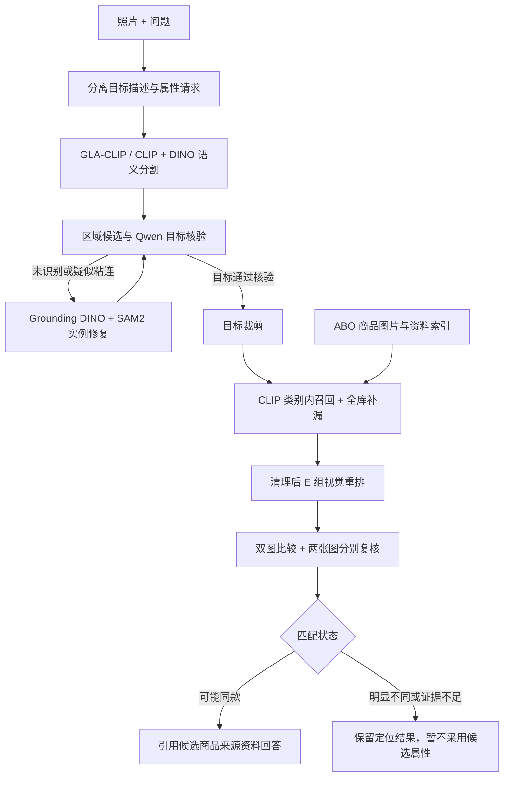

# 功能与架构

## 查询流程

实例修复最多尝试两次，不会无限重试。三态核验针对首位候选，不代表全库判断。修复不保证分开所有遮挡/粘连实例。

## 模块分工

| 模块 | 文件 | 职责 |
|---|---|---|
| 网页/API | `region_rag/web.html`, `web.py` | 原生 HTML/JS、本机 HTTP 服务；请求串行执行 |
| 编排 | `pipeline.py`, `workflow.py` | 分阶段启动进程，记录状态与来源 |
| 感知 | `vision.py`, `gla_clip_segmentor.py`, `overlap_kv.py` | 开放词汇分割、可选 KV 压缩、区域与 CLIP 向量 |
| 实例修复 | `repair.py`, `repair_core.py`, `vlm.py` | 检测、掩码、目标选择与复查 |
| 知识库 | `abo.py`, `catalog.py`, `recall.py` | 商品 ID 绑定资料；归一化 NumPy 向量索引与双路召回 |
| 重排 | `e_prepare.py`, `e_rerank.py`, `dpo_rerank.py` | DINO 局部对应、Qwen LoRA 图片对评分 |
| 核验/回答 | `match_verify.py`, `match_state.py`, `vlm.py` | 三态判断；有来源的属性选择与呈现 |
| 实验 | `posttrain_*.py`, `detail_*.py`, `training_quality.py` | SFT、DPO、排序训练、数据质量和消融 |

## 数据与模型

- 建库使用标准 CLIP CLS 图像向量；分割则使用该仓库修改后的密集视觉路径，二者不混用。
- 默认 E 组是 DPO 父模型上继续进行三元组排序＋CE 训练的 LoRA，不是全参数训练。局部对应成功时加入局部图，否则回退到高分辨率整体双图。
- 三態核验属于推理流程，不是 DPO 训练的三分类模型。相似度与 Yes/No 对数概率差均不等于同款概率。
- 索引是本地 NPZ，不依赖外部向量数据库或商业 API。模型在多个子进程中依次执行，退出后释放显存。
- 上传图片、阶段日志与结果保存在 `rag_data/jobs/`；商品路径写入本地索引，移动图片目录后需要重建索引。

## 现有实验边界

VOC21 位置合并：mIoU 66.26 → 66.19，峰值显存降低 30.11%；COCO-Stuff164k：26.94 → 26.95，降低 36.50%。ADE20K 上没有峰值显存收益，不能概括成普遍加速。

清理后 E 组在 120 条反复检查的商品图回归查询上 Top-1 为 47.50%，K=12 召回率 63.33%；不是完整室内场景问答的准确率，也不是独立泛化测试。三态流程尚未完成完整错误接受率校准。
